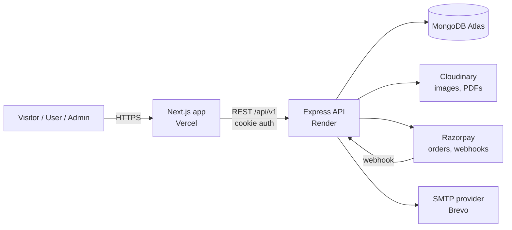

# Project Overview

## What BhaktiYatra is

BhaktiYatra is a web platform with two connected halves:

1. **Explore** — a rich, searchable, SEO-friendly directory of India's religious temples: history, significance, darshan timings, aarti schedules, festivals, how to reach, rules, maps, images and curated circuits such as Char Dham or the 12 Jyotirlingas.
2. **Travel** — organised pilgrimage tours built around those temples, with dated departures, seat inventory, online payment through Razorpay, digital tickets with QR codes, invoices and email confirmations, plus an admin back-office to run it all.

Explore brings visitors in. Travel turns some of them into customers. The content side is therefore built and launched first.

## Who it is for

| Audience | Needs |
|---|---|
| Pilgrims and devotees planning a visit | Accurate timings, how to reach, what to expect, nearby temples, festival dates |
| Families and senior citizens booking organised yatras | Trustworthy operator, clear itinerary, simple booking, a ticket they can show |
| Spiritually curious travellers and students | History, significance, legends, good photographs |
| The BhaktiYatra operations team (admin) | Manage content, tours, departures, seats, bookings, customers, payments |

## What it is not (first release)

- Not a marketplace for third-party operators. One operator (BhaktiYatra) runs all tours.
- Not a hotel, flight or train booking engine.
- Not a temple donation or online darshan booking system; it links out to official sites.
- Not a social network; reviews and community features come later.

## Primary interfaces

- **Public website** (Next.js): home, temples, circuits, tours, tour booking, account, static pages.
- **Admin dashboard** (same Next.js app under `/admin`, role-protected): content, tours, departures, bookings, users, contacts, audit.
- **REST API** (Express): consumed by the Next.js app; versioned under `/api/v1`.

## High-level architecture

Details: `02-architecture/01-system-architecture.md`.

## Release strategy

The first production release ("v1") ships when the success criteria in `02-vision-goals-success.md` are met. Development is phased (`08-phases/`); each phase has exit criteria and does not begin until the previous one passes.
