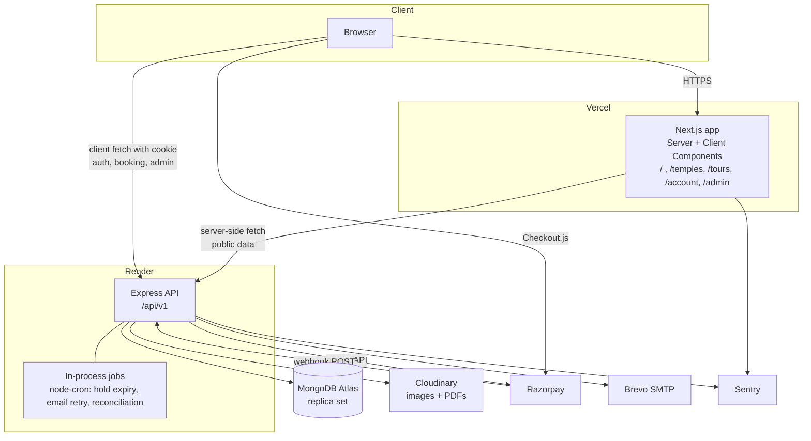
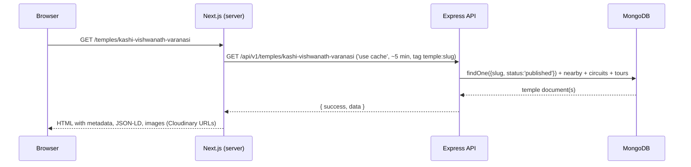

# System Architecture

## Components



## Responsibilities

| Component | Owns | Does not own |
|---|---|---|
| Next.js app | Rendering, routing, SEO metadata, sitemap, forms, client state, Razorpay Checkout launch, admin UI | Business rules, prices, inventory, auth decisions |
| Express API | Auth, validation, business rules, inventory, payments, documents, email, uploads, admin operations, jobs | Rendering HTML |
| MongoDB Atlas | Persistent data | Files |
| Cloudinary | Images (transformed delivery), generated PDFs (restricted) | — |
| Razorpay | Payment collection, webhooks | Booking state |
| Brevo | Email delivery | Templates (ours) |

## Data flow: public temple page (SEO path)



Public list and detail fetches are `'use cache'` functions with `cacheLife` (about 5 minutes) and cache tags such as `temple:<slug>` and `temples`. When admin publishes, the API calls `POST /api/revalidate` on the frontend with a shared secret, which runs `revalidateTag` for the affected tags. Fallback: the `cacheLife` expiry alone. Request-time data renders inside `<Suspense>` (Next 16 Cache Components, ADR-022).

## Data flow: booking and payment (summary)

See `05-features/04-booking-inventory.md` and `05-features/05-payments.md` for the full sequence. In short:

1. Client `POST /bookings` → API validates, atomically holds seats, creates Booking (pending) + Razorpay order + Payment (created) → returns order details.
2. Client opens Razorpay Checkout.
3. On success, client `POST /payments/verify` with signature → API verifies, confirms booking (idempotent), triggers documents and email job.
4. Independently, Razorpay `POST /webhooks/razorpay` → API verifies webhook signature → same confirmation service (idempotent).
5. Hold-expiry job marks stale pending bookings expired and releases seats.

## Backend layering

```
HTTP → middleware (requestId, helmet, cors, rateLimit, cookie, auth)
     → route → validate(zodSchema) → controller → service → model/provider
     ← error handler (maps AppError → envelope)
```

- **Controllers** parse validated input, call one service method, send the envelope. No business logic.
- **Services** hold business rules and orchestrate models and providers. Unit-tested.
- **Providers** wrap external systems (`razorpay.provider.js`, `cloudinary.provider.js`, `mail.provider.js`) behind small interfaces so tests can mock them.
- **Models** are Mongoose schemas with indexes and minimal hooks (slug generation, timestamps). No business rules in hooks.
- **Jobs** call services; they contain no logic of their own.

## Frontend structure (App Router)

- `app/(public)/…` public pages, Server Components, fetch via `lib/api/server.js` (adds no cookie).
- `app/(account)/…` user pages, Server Components for shell + Client Components for data needing cookies (fetched client-side via `lib/api/client.js` with `credentials: 'include'`), or server-side with forwarded cookie header.
- `app/admin/…` Client Components, protected by a layout that calls `/auth/me` and redirects.
- `components/ui` shadcn primitives; `components/temples`, `components/tours`, `components/bookings`, `components/layout`.
- `lib/` API clients, formatters, constants, zod form schemas; `messages/en.json` strings.

## Environments

| Env | Frontend | API | DB | Payments | Email |
|---|---|---|---|---|---|
| local | `localhost:3000` | `localhost:5000` | Atlas dev cluster or local Mongo | Razorpay test | Mailpit or Brevo sandbox |
| staging | `staging.<domain>` | `api-staging.<domain>` | Atlas staging db | Razorpay test | Brevo |
| production | `<domain>` | `api.<domain>` | Atlas prod cluster | Razorpay live | Brevo |

## Scaling notes (not for v1)

Single API instance is assumed because jobs run in-process. To scale: move jobs to a worker with a lock (Mongo-based or Redis), enable sticky-free sessions (already stateless), and add Cloudinary CDN caching headers.
