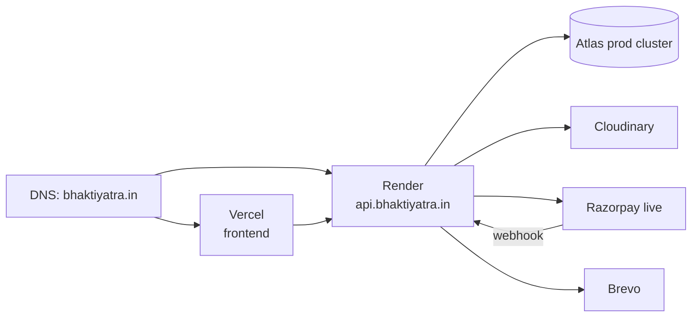

# Deployment Architecture

## Topology

Domain names are placeholders until OQ-1 is answered.

## Environments

| | Local | Staging | Production |
|---|---|---|---|
| Frontend | `npm run dev` on 3000 | Vercel preview/branch `staging` | Vercel `main` |
| API | `npm run dev` on 5000 | Render service `bhaktiyatra-api-staging` | Render service `bhaktiyatra-api` |
| DB | Atlas `bhaktiyatra_dev` or local | Atlas `bhaktiyatra_staging` | Atlas `bhaktiyatra` (separate cluster or project) |
| Razorpay | test keys | test keys, staging webhook URL | live keys, prod webhook URL |
| Email | Mailpit / Brevo test | Brevo, `[STAGING]` subject prefix | Brevo |
| Sentry | off or `development` env | `staging` | `production` |

## Frontend (Vercel)

- Root directory `frontend`; framework preset Next.js; Node version matching backend.
- Env: `NEXT_PUBLIC_API_BASE_URL`, `NEXT_PUBLIC_RAZORPAY_KEY_ID`, `NEXT_PUBLIC_SITE_URL`, `API_BASE_URL_INTERNAL` (server-side fetch), `REVALIDATE_SECRET`, `SENTRY_DSN`.
- Image domains: `res.cloudinary.com`.
- Custom domain with automatic TLS.

## API (Render)

- Root directory `backend`; build `npm ci`; start `node src/server.js`; health check path `/api/v1/health`.
- Instance: Starter or above (free tier sleeps and breaks webhooks and cron).
- Env: see `09-config/01-environment-variables.md`.
- `trust proxy` = 1. Port from `process.env.PORT`.
- Auto-deploy from `main` (production) and `staging` branch (staging).
- Persistent disk: **not used**. All files go to Cloudinary.

## Database (Atlas)

- Dedicated DB user per environment with `readWrite` on its database only.
- Network access: Render static outbound IPs allow-listed (or `0.0.0.0/0` only for dev with strong password, never prod).
- Backups: enable cloud backup on production tier; M0 relies on manual `mongodump` weekly until upgraded (document in ops).
- Indexes created by Mongoose `syncIndexes()` on boot in non-prod; in prod run `npm run db:sync-indexes` as a release step.

## Cloudinary

- One account, folders per environment: `bhaktiyatra/dev`, `/staging`, `/prod`.
- Upload presets unsigned are **not** used; all uploads are signed server-side.
- Delivery: images public with transformations; PDFs `private`.

## Razorpay

- Test mode until QA sign-off. Webhook configured per environment with secret in env.
- Events subscribed: `payment.captured`, `payment.failed`, `order.paid`, `refund.processed`.
- Live mode requires KYC (OQ-6) and switching keys in Render env only.

## Email (Brevo)

- Verified sender domain with SPF, DKIM, DMARC records.
- SMTP relay credentials in env. From address `bookings@<domain>`, reply-to support address.

## Release process

1. PR → CI green → merge to `staging` → auto-deploy → run smoke checklist on staging.
2. Merge `staging` → `main` → auto-deploy production.
3. Post-deploy: health check, create a test temple (unpublished), run a ₹1 live payment once at go-live and refund it, verify webhook received.
4. Tag release `v1.x.y`; update `CHANGELOG.md`.

## Rollback

- Vercel: promote previous deployment (instant).
- Render: redeploy previous commit from dashboard.
- Database: schema changes are additive in v1; no destructive migrations without a backup and a documented down-script.

## Smoke-test checklist (production)

- [ ] `/api/v1/health` returns 200 with `db: "up"`.
- [ ] Home, a temple page, a tour page render with correct metadata (view source).
- [ ] Login works and cookie is set on the correct domain.
- [ ] Admin dashboard loads.
- [ ] Booking flow in test mode on staging; on production a real ₹1 test refunded.
- [ ] Webhook delivery shows success in Razorpay dashboard.
- [ ] Confirmation email received with attachments.
- [ ] Sentry receives a deliberate test event.
- [ ] Sitemap accessible; robots allows crawl.
