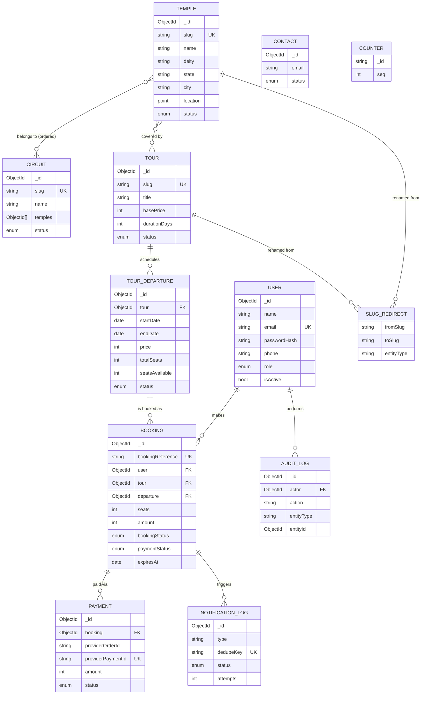

# Database Schema Overview

MongoDB Atlas, Mongoose ODM. One database per environment. Collections are listed with their purpose; field-level detail is in `02-models.md`.

## Entity relationship diagram

## Collections at a glance

| Collection | Purpose | Written by | Phase |
|---|---|---|---|
| `users` | Accounts and roles | auth, admin | 2 |
| `temples` | Temple content | admin content | 3 |
| `circuits` | Curated temple groups | admin content | 3 |
| `slugredirects` | Old slug → new slug for 301s | admin content | 3 |
| `contacts` | Contact-form messages | public | 3 |
| `tours` | Tour templates | admin | 4 |
| `tourdepartures` | Dated runs with inventory | admin, booking service | 4 |
| `bookings` | Reservations | booking, payment, admin | 5 |
| `payments` | Provider payment attempts and outcomes | payment service | 6 |
| `notificationlogs` | Email jobs and delivery state | notification service, jobs | 7 |
| `auditlogs` | Sensitive action trail | all admin/payment services | 2+ |
| `counters` | Sequential numbers (invoice) | document service | 7 |

## Design principles

1. **Snapshot what matters historically.** Bookings copy `unitPrice`, `amount`, tour title, departure dates and pickup at creation so later edits do not rewrite history.
2. **Inventory lives in one place.** `tourdepartures.seatsAvailable` is the only authoritative free-seat count. Everything else is derived for reconciliation.
3. **Status enums are closed sets** defined in `backend/src/config/constants.js` and mirrored in `frontend/lib/constants.js`.
4. **No polymorphic references.** `AuditLog.entityType` + `entityId` is the one exception, used for display only.
5. **Soft delete via status.** Temples, circuits, tours use `archived`; users use `isActive`. Hard deletes only for draft content with no references and for test data.
6. **Money is integer INR.** See ADR-011.
7. **Dates are UTC `Date` objects.** `startDate` for departures is stored as midnight IST converted to UTC; display logic uses `Asia/Kolkata`.
8. **Text search** uses a MongoDB text index in v1 (name, city, deity, tags, shortDescription). Atlas Search can replace it later without model changes.
