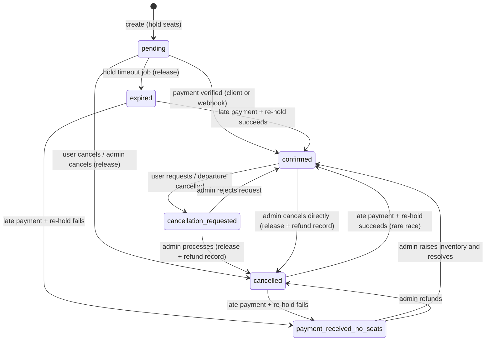

# Feature: Booking and Seat Inventory

Requirements: FR-BOOK-01…09. Phase 5. This is the most sensitive non-payment logic in the system; read with `05-payments.md`.

## Reservation strategy (ADR-006)

**Hold at creation.** When a booking is created, the requested seats are atomically subtracted from `departure.seatsAvailable` and the booking gets `holdExpiresAt = now + HOLD_MINUTES (15)`. The hold is released when the booking is cancelled by the user or expires. Payment confirmation keeps the seats.

Why: it guarantees no overselling during checkout, is simple to reason about, and the only cost is a cron job and a visible countdown.

## State machine



Allowed transitions are encoded in one table in `bookings.service.js` (`TRANSITIONS[from][to] = handler`). Any other request → 409 `INVALID_TRANSITION`.

Payment status is tracked separately: `pending → paid → refunded | partially_refunded`, or `pending → failed` (can go back to `pending` on retry while booking is pending).

## Booking creation (detailed)

Preconditions checked in order, each with its error:
1. User authenticated and active.
2. Departure exists, tour `published`, departure `scheduled` → else 404 / 410 `DEPARTURE_CLOSED`.
3. `now < startDate − cutoffHours` → else 410 `DEPARTURE_CLOSED`.
4. `1 ≤ seats ≤ MAX_SEATS_PER_BOOKING (10)`, `travellers.length === seats`, each traveller valid → 422.
5. User's pending bookings < 3 → else 409 `TOO_MANY_PENDING` (prevents hoarding holds).
6. Atomic hold → else 409 `SEATS_UNAVAILABLE` with current availability.
7. Razorpay order creation → on failure release hold, 502.
8. Persist Booking + Payment; on failure release hold, log orphaned Razorpay order id for reconciliation.

Timeline entry: `{ event: 'created', meta: { seats, amount, holdExpiresAt } }`.

Idempotency: `Idempotency-Key` header stored in a short-lived in-memory/Mongo map keyed by user+key for 10 min; replay returns the stored response (prevents double holds on double-click or retry).

## Hold expiry job

Every minute:
```
for booking in bookings.find({ bookingStatus:'pending', holdExpiresAt: { $lt: now } }).limit(200):
  session.withTransaction:
    r = bookings.updateOne({ _id, bookingStatus:'pending' }, { $set: { bookingStatus:'expired' }, $push: timeline 'expired' })
    if r.modifiedCount == 1:
      departures.updateOne({ _id: dep }, { $inc: { seatsAvailable: seats } })
      if departure.status == 'full' and seatsAvailable > 0: set 'scheduled'
      payments.updateOne({ booking, status:'created' }, { $set: { status:'failed', failureReason:'hold_expired' } })
```
Safe to run concurrently because the first `updateOne` is the guard. Logged with counts. Metrics: `holds.expired`.

## Late payment handling

A verified capture can arrive after expiry (user paid at minute 14:59, webhook at 15:30). Policy: **honour the payment if seats can be re-acquired**.
- Re-hold: `departures.updateOne({ _id, seatsAvailable: { $gte: seats } }, { $inc: -seats })`.
- Success → `confirmed` with timeline `confirmed_late`.
- Failure → `payment_received_no_seats`, `paymentStatus: paid`; admin alert; user email "We received your payment but seats sold out; we will contact you within 24 h for an alternative or refund" (template `payment_received_no_seats`, Should).

## User cancellation

- Pending: immediate `cancelled`, release, Payment `failed(cancelled_by_user)`. If the user already paid in Razorpay but verify hasn't happened, the later capture follows the late-payment path (re-hold).
- Confirmed: `cancellation_requested` with reason; UI explains the policy and that admin will process the refund; admin notified.

## Countdown UX

Booking page after creation shows "Complete payment within 14:59" (server `holdExpiresAt`, client ticks). At 0 the UI disables pay, shows "Your hold expired" with "Try again" (creates a new booking). If Razorpay Checkout is open at expiry, the UI still allows completion; backend handles via late-payment path.

## Reconciliation job (hourly)

For each departure `scheduled|full` with startDate ≥ today − 1: compute `committed = Σ seats where bookingStatus ∈ {pending, confirmed, cancellation_requested}`; expect `totalSeats − committed === seatsAvailable`. On mismatch: log error with ids and diff, Sentry event, dashboard alert count. No auto-fix in v1; `npm run db:reconcile -- --fix` exists for admins.

## Edge cases

| Case | Behaviour |
|---|---|
| Double submit of booking form | Idempotency key → same response; UI disables button after first click |
| Seats drop between page load and submit | 409 with current availability; UI updates selector and asks to confirm |
| User has a pending booking on the same departure | Allowed up to 3 pending total; UI shows banner "You have a pending booking, complete payment" with link |
| Departure cancelled while pending | Job/admin action expires pending bookings; UI shows "Departure cancelled" |
| Clock skew between server and client | Countdown uses server timestamp delta measured at response time |
| Job crashes mid-batch | Each booking its own transaction; next run picks up the rest |

## Acceptance criteria

- [ ] Concurrency test: 20 parallel creates for a departure with 5 seats → exactly 5 seats held, 15 × 409.
- [ ] Expiry job releases seats and sets `expired` within one run; departure returns from `full` to `scheduled`.
- [ ] Late capture after expiry with seats available → `confirmed`; without seats → `payment_received_no_seats` and admin alert.
- [ ] Invalid transitions return 409 for every disallowed pair (table-driven test).
- [ ] Reconciliation detects an injected mismatch.
- [ ] Idempotency-Key replay returns identical body and creates no second booking.
- [ ] UI countdown reaches zero and disables payment; "Try again" creates a new booking.
