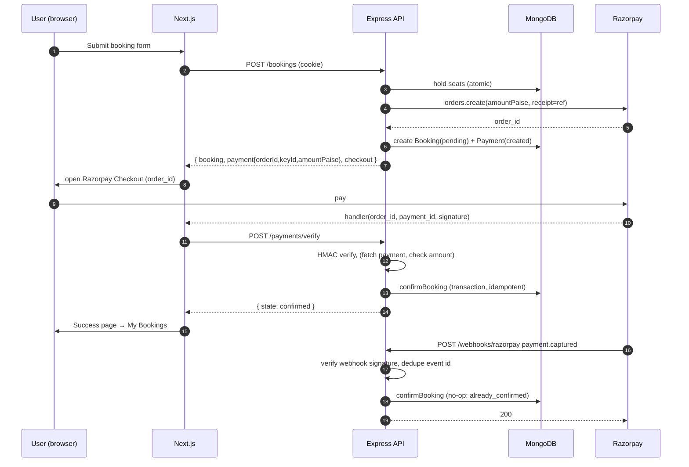

# Feature: Razorpay Payments

Requirements: FR-PAY-01…08. Phase 6. Depends on `04-booking-inventory.md`.

## Sequence

Either path may arrive first. Both call the same `confirmBooking` service.

## Client integration

- Load `https://checkout.razorpay.com/v1/checkout.js` lazily on the booking page (not globally).
- Options: `key` (from API response), `order_id`, `amount`, `currency`, `name`, `description`, `prefill`, `notes: { bookingReference }`, `theme.color`, `modal.ondismiss` → mark UI "Payment cancelled, you can retry until the hold expires", `retry: { enabled: false }` (we control retries by reopening with the same order).
- On `handler` success → call verify → show state.
- On `payment.failed` event → show message from `error.description`, keep order, allow retry (reopen checkout with same `order_id`) while hold is active.
- Verify call timeout 20 s; on network failure show "We're confirming your payment… this page will update" and poll `GET /bookings/:reference` every 5 s for up to 60 s; after that show "Pending: you'll receive an email when confirmed" (webhook path will finish it).

## Server rules

- Amount is `departure.price × seats × 100` paise computed server-side.
- Razorpay order `receipt` = booking reference; `notes.bookingReference` for dashboard searchability.
- Client verify requires the authenticated user to own the booking.
- Signature check uses `crypto.timingSafeEqual`.
- (Should) `payments.fetch(payment_id)` from Razorpay and assert `order_id` matches, `amount === amountPaise`, `currency === 'INR'`, `status ∈ {captured, authorized}`. If `authorized` but not captured (auto-capture is on by default; keep it on), treat as captured only after webhook `payment.captured`.
- Webhook route uses raw body; mounted before JSON parser; no auth; no CSRF origin check; rate limit generous (600/min).
- Processed webhook event ids stored on the Payment; duplicates return 200 without work.
- Failures from Razorpay API (order create) → 502 `PROVIDER_ERROR`, hold released.

## Payment record lifecycle

| Event | Payment.status | Booking.paymentStatus |
|---|---|---|
| Order created | `created` | `pending` |
| Checkout dismissed | `created` | `pending` |
| `payment.failed` webhook | `failed` (reason) | `pending` (retry allowed) |
| Signature mismatch on verify | `failed` (`signature_mismatch`) | `pending` |
| Verified capture | `captured`, `signatureVerified`, `verifiedVia` | `paid` |
| Hold expired without capture | `failed` (`hold_expired`) | `pending` → booking `expired` |
| Refund processed webhook | `refunded` | `refunded` / `partially_refunded` |

A booking may have multiple Payment documents only in the manual-payment case; normal flow has one Payment per booking (one Razorpay order supports multiple attempts; the record is updated, and the final `providerPaymentId` is the captured one).

## Reconciliation

Hourly job (Should, Phase 8): for bookings `pending` with `createdAt` 20–120 min ago, call Razorpay `orders.fetchPayments(order_id)`; if a captured payment exists that we missed, run `confirmBooking`. Logs discrepancies. This covers lost webhooks and failed verify calls.

## UI states (FR-PAY-06)

| State | Message | Actions |
|---|---|---|
| creating | "Preparing your booking…" | none |
| awaiting_payment | Countdown + "Pay ₹49,998" | Pay, Cancel booking |
| checkout_open | Razorpay modal | — |
| verifying | "Confirming payment…" spinner (≤ 20 s) | none |
| confirmed | "Booking confirmed! Reference BY-…" | View ticket, My bookings |
| failed | Provider message + "Your seats are still held for mm:ss" | Retry payment, Cancel |
| cancelled_by_user | "Payment cancelled" | Retry, Cancel booking |
| expired | "Your hold expired" | Try again |
| pending_confirmation | "Payment received, confirming… we'll email you" | My bookings |
| payment_received_no_seats | "Payment received but seats sold out; we'll contact you within 24 h" | Contact |

## Security checklist

- [ ] Key secret and webhook secret only in backend env.
- [ ] Amount never read from client.
- [ ] Constant-time comparisons.
- [ ] Owner check on verify.
- [ ] Webhook raw body + signature + event dedupe.
- [ ] No card/UPI details stored; `rawSnapshot` whitelist: id, order_id, amount, currency, status, method, email, contact, created_at, error_code, error_description.

## Acceptance criteria

- [ ] Valid signature → confirmed; tampered signature → 400 and booking still pending.
- [ ] Webhook with wrong secret → 400; with correct secret → confirmed; replay same event id → 200 no change.
- [ ] Verify then webhook, and webhook then verify, both yield exactly one confirmation, one NotificationLog, one AuditLog.
- [ ] Amount mismatch (mocked fetch) → 409 and admin alert.
- [ ] UI never shows an indefinite spinner (Playwright test with blocked verify endpoint → pending state in ≤ 60 s).
- [ ] Order creation failure releases the hold (test with mocked provider throwing).
