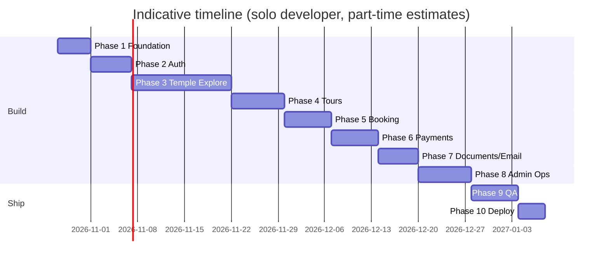

# Development Roadmap

Phases run strictly in order. A phase starts only when the previous phase's exit criteria pass and the owner approves. Each phase has its own file with tasks, deliverables and exit criteria.

| Phase | Name | Main outcome | Depends on | Status |
|---|---|---|---|---|
| 0 | Specification | This `docs/` tree approved | — | done |
| 1 | Foundation | Monorepo, both apps boot, env validation, health check, CI, secrets cleaned | 0 | done (`10-testing/reports/phase-1.md`) |
| 2 | Authentication | Register/login/logout/me/profile/reset, roles, guards, audit base, Google sign-in | 1 | done (`10-testing/reports/phase-2.md`) |
| 3 | Temple Explore | Temples, circuits, admin content tools, public pages, SEO, sitemap, static pages | 2 | built; Lighthouse Performance and Rich Results Test open (`10-testing/reports/phase-3.md`) |
| 4 | Tours & Departures | Tour catalogue, departures, inventory admin | 3 | built; Lighthouse Performance open (`10-testing/reports/phase-4.md`) |
| 5 | Booking & Inventory | Holds, expiry job, booking pages, state machine | 4 | done; payments simulated until Phase 6 (`10-testing/reports/phase-5.md`) |
| 6 | Payments | Razorpay order, verify, webhook, idempotent confirmation, payment UI | 5 | built and tested with a fake Razorpay; a real test-mode payment needs new test keys (`10-testing/reports/phase-6.md`) |
| 7 | Documents & Email | Ticket, QR verify, invoice, email queue with retry, secure downloads | 6 | built; real inbox delivery and phone QR scan to check (`10-testing/reports/phase-7.md`) |
| 8 | Admin Operations | Dashboard, bookings/payments/users/contacts admin, cancellations, audit viewer | 7 | built; Excel check of the CSV by the owner (`10-testing/reports/phase-8.md`) |
| 9 | Quality Assurance | Full test pass, E2E, a11y, performance, security review | 8 | automated QA done; Lighthouse Performance, 60 temples and owner checks open (`10-testing/reports/phase-9.md`) |
| 10 | Deployment & Handover | Staging + production live, smoke tests, runbook | 9 | prepared (render.yaml, rewrite, guide); waiting for the owner to create the services (`09-config/05-deployment-guide.md`) |

Dates are indicative working days, not commitments. Content writing (≥ 60 temples) runs in parallel from Phase 3 onward and is usually the real critical path.

## Rules for every phase

1. Start by re-reading `PROJECT_CONTEXT.md`, `CLAUDE.md` and the phase file.
2. Work on a branch `phase-<n>/<short-name>`.
3. Deliver small vertical slices (model → service → route → UI → test).
4. Update docs touched in the same commit.
5. Finish with a phase report: what was built, tests run with results, known gaps, env changes, decisions made.
6. Owner reviews the running app against the exit criteria before the next phase begins.

## Parallel tracks (owner, non-code)

| Track | Needed by |
|---|---|
| Rotate leaked credentials | Before Phase 1 |
| Create Cloudinary, Brevo, Sentry accounts | Phase 1 (Cloudinary by Phase 3) |
| Review Claude-drafted temple content (ADR-015) | Phase 3 onward |
| ~~Business details for tickets/invoices (OQ-2)~~ | Done 2026-10-20 |
| ~~Cancellation policy text (OQ-3)~~ | Draft done 2026-10-20; legal review before live payments |
| Domain purchase (OQ-1) | Deferred; needed before Phase 10 |
| Razorpay live KYC (OQ-6) | Phase 10 |
